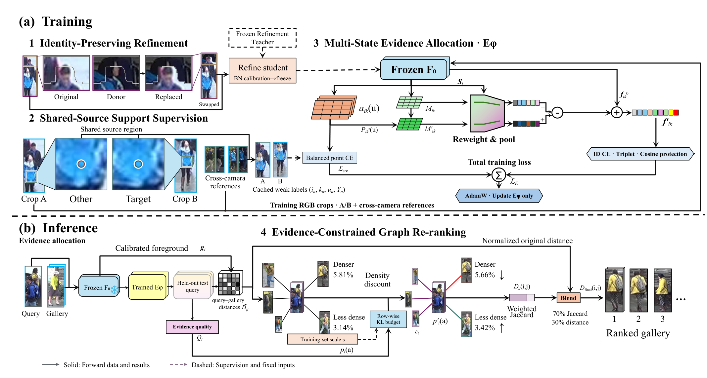

# TIERNet

**Identity Evidence Is Target-Relative: Constrained Redistribution for Occluded Person Re-Identification**

Enhao Ning, Jicheng Yuan, Yiwen Liu, and Xin Ning

The **Target-relative Identity Evidence Redistribution Network (TIERNet)** estimates whether a visible region supports the target identity, another identity, or neither reliably. These predictions guide part pooling and visibility weighting. During retrieval, they set the evidence budget for redistribution within reciprocal neighborhoods.



## Results

The table reports the complete model with evidence-constrained graph re-ranking, as in Table II of the manuscript.

| Dataset | Rank-1 (%) | mAP (%) |
| --- | ---: | ---: |
| Occluded-Duke | 85.40 | 84.40 |
| Occluded-REID | 91.10 | 92.10 |
| P-Duke | 96.10 | 93.80 |
| Market-1501 | 97.20 | 95.80 |
| MSMT17 | 90.80 | 85.40 |

The Occluded-REID result uses the model trained on Market-1501. The evaluation commands below reproduce the Occluded-Duke protocol.

## Installation

The reference evaluation uses Linux, Python 3.10, and a CUDA GPU with BF16 support.

```bash
git clone https://github.com/Enhao919/occluded-reid-evidence.git
cd occluded-reid-evidence
python -m pip install torch==2.7.1 torchvision==0.22.1 --index-url https://download.pytorch.org/whl/cu128
python -m pip install -r requirements.txt
```

## Evaluate on Occluded-Duke

Obtain [Occluded-Duke](https://github.com/lightas/Occluded-DukeMTMC-Dataset) and keep its three split directories under a common root.

```text
Occluded-Duke/
├── bounding_box_train/
├── query/
└── bounding_box_test/
```

Download the [Occluded-Duke checkpoint](https://github.com/Enhao919/occluded-reid-evidence/releases/download/v1.0.0/tiernet_occluded_duke.pt) and save it as `weights/tiernet_occluded_duke.pt`. The checkpoint contains the calibrated encoder and trained evidence branch for the complete TIERNet model.

SHA-256 `5653a84d25421f91c894dc0f33a10f7a09c0a2849e2a8d47d2ff929b725305c7`

```bash
python reproduce.py test \
  --data-root /path/to/Occluded-Duke \
  --checkpoint weights/tiernet_occluded_duke.pt \
  --output runs/occluded_duke_eval --gpu 0
```

The evaluator uses the training split to calibrate evidence quality and ranks the full gallery for all 2,210 queries. It writes Rank-1 and mAP as percentages to `RESULT.json` in the output directory. ECGR constructs the full query and gallery graph in host memory.

## Training

See [the training guide](docs/training.md) for preparing the part labels and shared-source supervision, and for training and resuming the model.

## Citation

```bibtex
@misc{ning2026tiernet,
  author = {Ning, Enhao and Yuan, Jicheng and Liu, Yiwen and Ning, Xin},
  title = {Identity Evidence Is Target-Relative: Constrained Redistribution for Occluded Person Re-Identification},
  year = {2026}
}
```

## Acknowledgments

TIERNet builds on [SOLIDER](https://github.com/tinyvision/SOLIDER), [BPBreID](https://github.com/VlSomers/bpbreid), and [KPR](https://github.com/VlSomers/keypoint_promptable_reidentification). See [NOTICE.md](NOTICE.md) for source credits and third-party licenses.
